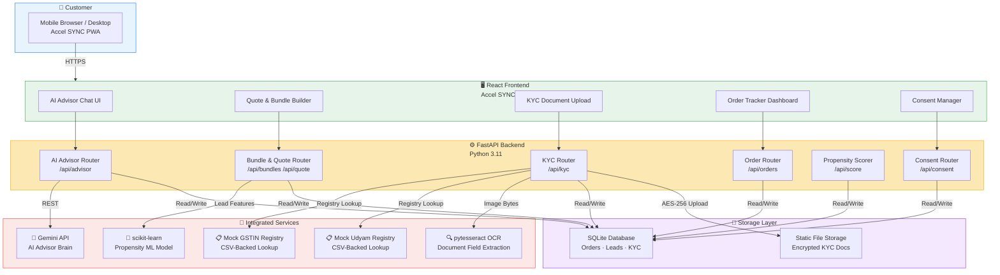
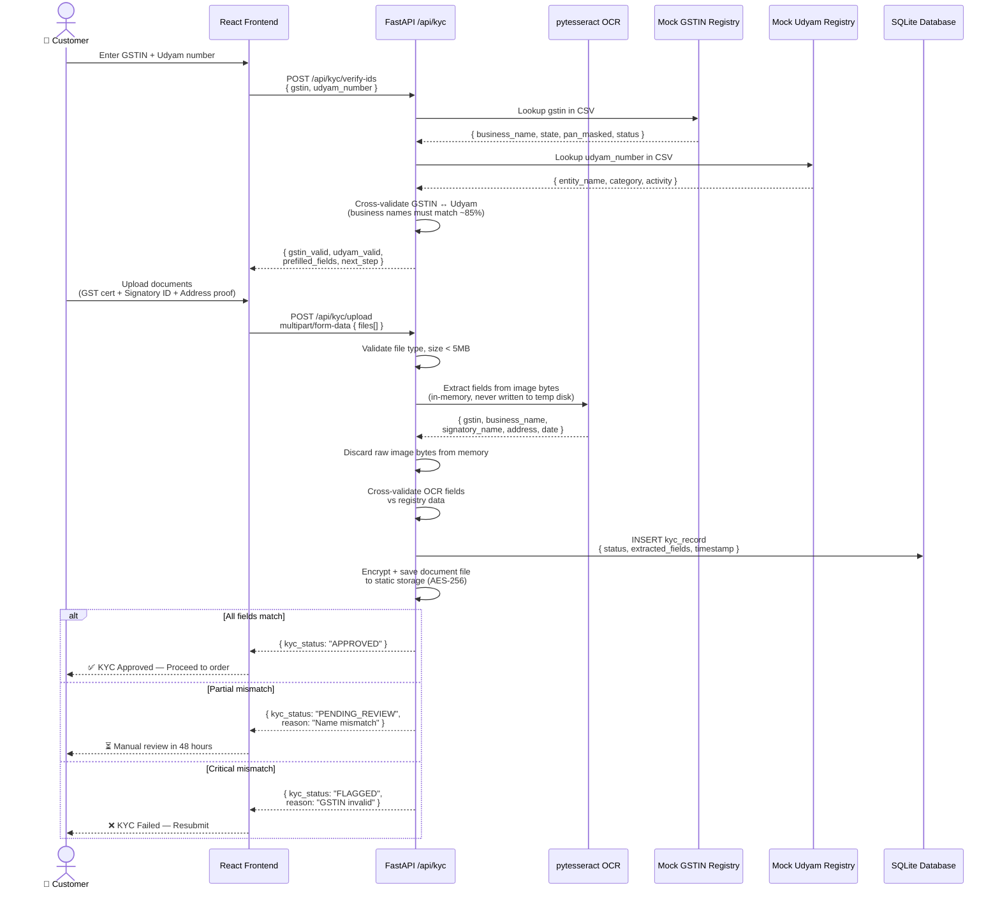
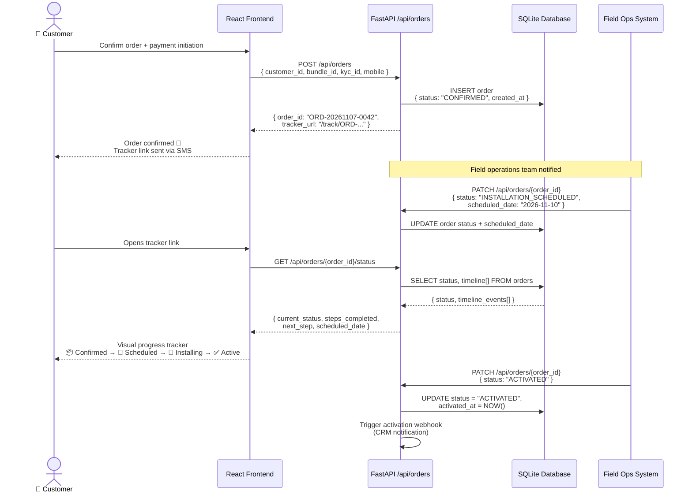

# Accel SYNC — Solution Architecture

> **Platform:** Accel SYNC | Digital-First MSME Acquisition & Onboarding
> **Version:** 1.0 | YTL Hackathon 2026
> **Last Updated:** November 2026

---

## 1. System Overview

Accel SYNC is a Progressive Web Application (PWA) built to eliminate the friction in Airtel Business's MSME customer acquisition funnel. The platform replaces a 17.6-day, multi-touchpoint sales cycle with a fully self-serve digital experience that a business owner can complete in under 60 minutes from any smartphone.

### End-to-End Digital Journey

A prospective MSME customer lands on the Accel SYNC PWA — reachable via a QR code, SMS deep-link, or partner referral URL. The journey unfolds in four sequential modules, each backed by a distinct set of backend services:

**Module 1 — AI Advisor (Needs Discovery)**
The customer interacts with a conversational AI powered by Google Gemini. Rather than filling out static forms, the customer describes their business in natural language. Gemini extracts business type, size, connectivity requirements, and existing services, then recommends a curated bundle from Airtel's MSME catalog. The session remains stateless — no personally identifiable information is persisted at this stage — ensuring DPDP Act compliance from the first interaction.

**Module 2 — Quote & Checkout**
The recommended bundle is presented as a transparent, itemized quote with line-by-line pricing and a bundle discount clearly indicated. The customer can modify the bundle (add/remove add-ons), select a payment tenure, and proceed to checkout. A propensity score calculated by a scikit-learn ML model guides upsell nudges shown to the customer.

**Module 3 — Smart KYC**
Airtel Business requires GST and Udyam verification for MSME onboarding. Accel SYNC digitizes this entirely:
- **Step 1:** Customer enters their GSTIN and Udyam number.
- **Step 2:** The backend performs an instant registry lookup against mock CSV-backed GSTIN and Udyam registries (production: live API calls).
- **Step 3:** Customer uploads supporting documents (GST certificate, signatory ID, address proof) via a guided document camera UI.
- **Step 4:** pytesseract OCR extracts the five required fields from each document. The raw image is discarded from memory immediately post-extraction.
- **Step 5:** Extracted fields are cross-validated against the registry data. A KYC status of APPROVED, PENDING_REVIEW, or FLAGGED is returned within seconds.

**Module 4 — Order Tracker**
Once KYC is approved and payment is initiated, an order record is created in the SQLite database (production: PostgreSQL). The customer receives a unique Order ID and can track installation progress in real-time through a self-service tracker — eliminating the need for follow-up calls.

---

## 2. Architecture Diagram

---

## 3. Data Flow Diagrams

### 3a. AI Advisor Conversation Flow

```mermaid
sequenceDiagram
    actor User as 👤 Customer
    participant FE as React Frontend
    participant API as FastAPI /api/advisor
    participant Gemini as Google Gemini API

    User->>FE: Types business description<br/>("I run a 3-chair salon in Pune")
    FE->>API: POST /api/advisor/chat<br/>{ message, session_id }
    API->>API: Build system prompt<br/>(MSME catalog + rules injected)
    API->>Gemini: POST /v1/generateContent<br/>{ system_prompt + user_message }
    Gemini-->>API: JSON { candidates[0].content }
    API->>API: Parse recommended bundle_id<br/>from structured response
    API-->>FE: { reply_text, recommended_bundle,<br/>follow_up_questions, session_id }
    FE-->>User: Display AI response +<br/>bundle recommendation card

    alt Customer asks follow-up
        User->>FE: Follow-up question
        FE->>API: POST /api/advisor/chat<br/>{ message, session_id, history[] }
        API->>Gemini: POST /v1/generateContent<br/>{ history + new message }
        Gemini-->>API: Refined recommendation
        API-->>FE: Updated response
        FE-->>User: Updated recommendation
    end

    alt Confusion detected (3+ unresolved turns)
        API-->>FE: { escalate: true,<br/>handoff_url: "/contact-sales" }
        FE-->>User: Warm handoff to sales agent
    end
```

### 3b. KYC Verification Flow

### 3c. Order Tracking Flow

---

## 4. Component Descriptions

| Component | Technology | Purpose | Key APIs / Interfaces |
|---|---|---|---|
| **React Frontend (PWA)** | React 18, Vite, TailwindCSS, Workbox | Full customer-facing interface; works offline for tracker; installable on Android homescreen | Communicates with FastAPI via REST+JSON; uses service worker for caching |
| **FastAPI Backend** | Python 3.11, FastAPI, Uvicorn, Pydantic | Central API layer; handles all business logic, routing, validation, and orchestration | REST API; exposes `/api/advisor`, `/api/kyc`, `/api/orders`, `/api/bundles`, `/api/consent` |
| **Gemini API** | Google Gemini 1.5 Flash (hackathon), Gemini 1.5 Pro (production) | Powers the AI Advisor; interprets natural language business descriptions; recommends bundles | `POST /v1/models/gemini-1.5-flash:generateContent` with structured output instructions |
| **Mock GSTIN Registry** | Python CSV reader (pandas), in-memory lookup | Simulates India's GST registry for GSTIN validation and business detail retrieval | Internal function call; production replaces with GSTN Sandbox API |
| **Mock Udyam Registry** | Python CSV reader (pandas), in-memory lookup | Simulates Udyam registration portal for MSME eligibility verification | Internal function call; production replaces with Udyam Assist API |
| **pytesseract OCR** | pytesseract 0.3.x, Tesseract 5.x, Pillow | Extracts structured fields from uploaded document images entirely on-premise | Python function call; processes bytes in-memory; no external API call |
| **SQLite Database** | SQLite 3, SQLAlchemy ORM, Alembic migrations | Persists orders, leads, KYC records, consent logs, and propensity scores | SQL via SQLAlchemy sessions; schema managed by Alembic |
| **scikit-learn ML Model** | scikit-learn 1.4, joblib (model serialisation) | Propensity scoring: predicts likelihood of a lead converting based on segment, GSTIN status, and bundle interest signals | Loaded at startup via `joblib.load()`; `model.predict_proba(features)` |
| **Static File Storage** | Local filesystem (hackathon), AES-256 encrypted | Stores uploaded KYC document images with time-limited access URLs | Python `cryptography` library for encryption; production replaces with GCS/S3 + signed URLs |
| **Consent Manager** | FastAPI router + SQLite `consent_logs` table | Records granular consent actions (timestamp, IP hash, user agent) for DPDP compliance | `POST /api/consent/record`, `POST /api/consent/withdraw`, `GET /api/consent/status` |

---

## 5. Security Architecture

Accel SYNC is designed with the **Digital Personal Data Protection (DPDP) Act 2023** as a first-class constraint, not an afterthought.

### 5.1 Consent-First Design

Every data collection point is preceded by a consent checkpoint. Consent is:
- **Granular** — separate consent items for KYC verification, order communications, and marketing
- **Explicit** — no pre-ticked checkboxes; each item requires positive opt-in
- **Withdrawable** — a customer can withdraw optional consents at any time via `POST /api/consent/withdraw`
- **Logged** — every consent action is written to the `consent_logs` table with ISO-8601 timestamp, pseudonymous IP hash (SHA-256 of full IP, not stored raw), and user agent

### 5.2 Data Minimization in Practice

| Sensitive Field | How It Is Handled |
|---|---|
| PAN (embedded in GSTIN chars 3–12) | Masked in all logs and UI as `XXXXXXXXXX`; never stored separately |
| Aadhaar (if present on ID docs) | OCR trained to extract only last 4 digits; full number never stored |
| Raw document images | Discarded from memory immediately after OCR field extraction |
| AI chat transcript | Session-scoped only; not persisted to database; cleared on session end |
| Full IP address | Hashed (SHA-256) before storage in consent logs |

### 5.3 Encryption & Access Control

- **At rest:** KYC document files encrypted with AES-256 using `cryptography.fernet`
- **In transit:** All API endpoints served over HTTPS (TLS 1.3) in production
- **Database field encryption:** GSTIN, Udyam number, and mobile number stored with application-level field encryption (not plaintext in SQLite)
- **Document access:** Time-limited signed tokens (15-minute expiry) for document retrieval; no direct filesystem paths exposed to the frontend
- **API authentication:** JWT tokens (HS256, 1-hour expiry) for authenticated endpoints; short-lived OTP for initial login

### 5.4 Third-Party Data Processor Obligations

| Processor | Data Shared | Safeguard |
|---|---|---|
| Google Gemini API | AI chat messages (no PII — stripped before sending) | Data Processing Agreement; `safetySettings` configured; not used for model training |
| pytesseract / Tesseract | Document bytes | Runs entirely on-premise; zero data egress |
| No third-party analytics | — | No analytics SDK embedded on KYC pages |

### 5.5 Data Principal Rights Implementation

| DPDP Right | Endpoint | Behaviour |
|---|---|---|
| Access | `GET /api/my-data/{mobile}` | Returns all stored data fields in JSON |
| Correction | `PATCH /api/my-data/{mobile}` | Updates correctable fields; logs the correction |
| Erasure | `DELETE /api/my-data/{mobile}` | Hard-deletes all data except legally-mandated retention (GSTIN/Udyam: 7 years per GST Act) |
| Grievance | `grievance@accelsync.in` | 30-day resolution SLA per DPDP Act Section 13 |

---

## 6. Scalability Notes

The hackathon implementation uses lightweight, zero-infrastructure-cost components for rapid prototyping. The table below documents the precise production upgrade path for each component.

| Component | Hackathon (Current) | Production Upgrade | Scaling Strategy |
|---|---|---|---|
| **Database** | SQLite (single-file) | PostgreSQL 16 (managed: Cloud SQL / RDS) | Connection pooling via PgBouncer; read replicas for order tracker queries |
| **Backend** | Uvicorn single-process | Uvicorn + Gunicorn (4 workers) → Kubernetes pods | Horizontal pod autoscaling on CPU/request rate; stateless design enables easy horizontal scale |
| **AI Advisor** | Gemini 1.5 Flash | Gemini 1.5 Pro + response caching (Redis) | Cache identical business-type prompts; rate limiting with token bucket algorithm |
| **GSTIN/Udyam Lookup** | CSV in-memory | Live GSTN Sandbox API + Redis cache (TTL 24h) | Cache validated GSTINs; reduces API calls by ~80% for returning customers |
| **OCR Service** | pytesseract (in-process) | Dedicated OCR microservice (FastAPI + Celery workers) | Async document processing queue; horizontal workers for peak upload periods |
| **ML Model** | joblib file, loaded at startup | MLflow model registry + A/B testing framework | Canary model rollout; shadow scoring for new model validation |
| **File Storage** | Local filesystem | Google Cloud Storage / AWS S3 + signed URLs | CDN for read acceleration; lifecycle rules for 90-day auto-deletion |
| **Frontend** | Vite dev server | Nginx static hosting + CDN (Cloudflare) | Edge caching; PWA service worker handles offline mode |
| **Authentication** | Simple JWT | Firebase Auth / Cognito + OTP via Airtel SMS | Federated identity; SMS OTP via Airtel's own SMS gateway (zero cost) |
| **Monitoring** | Console logs | Cloud Logging + Prometheus + Grafana | Alerting on KYC failure rate, Gemini latency P99, order activation lag |

### 6.1 Estimated Production Infrastructure Cost (Base Case)

| Service | Monthly Cost (est.) |
|---|---|
| Cloud SQL PostgreSQL (db-g1-small) | ₹6,000 |
| Cloud Run (FastAPI, 2 vCPU autoscale) | ₹8,000 |
| Google Cloud Storage (50 GB docs) | ₹500 |
| Gemini API (Gemini 1.5 Flash, 10M tokens/mo) | ₹12,000 |
| Redis Cache (Memorystore, 1 GB) | ₹4,000 |
| **Total** | **~₹30,500/month** |

At ₹4,500 average ARPU and 9,000 activations (base case), infrastructure cost represents < 0.1% of revenue — well within acceptable SaaS operating ratios.

---

*Document maintained by the Accel SYNC engineering team. For architecture questions, contact the platform lead.*
