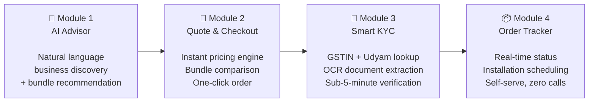
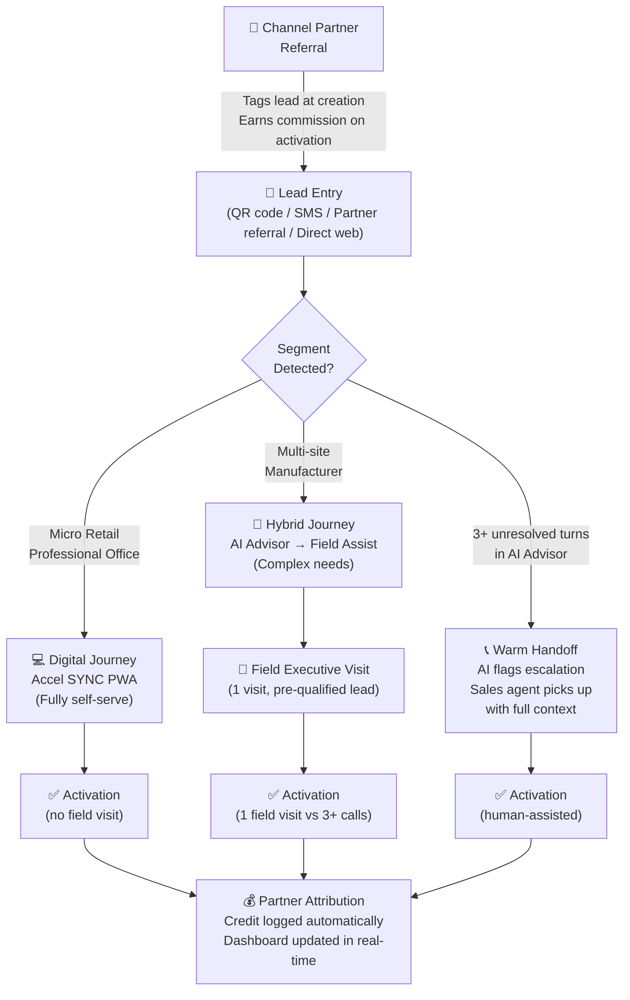
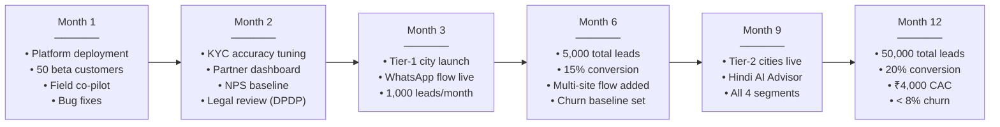
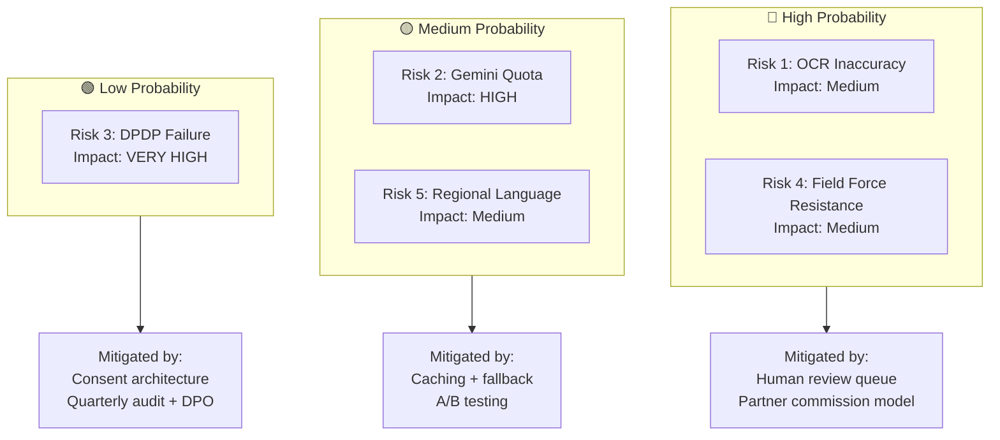
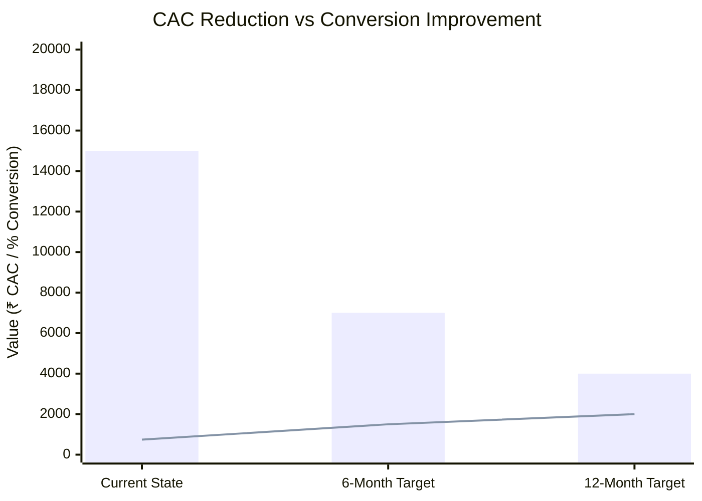

# Accel SYNC — Business Case
## YTL Hackathon 2026 | Airtel Business MSME Digital Acquisition Platform

> **Presenter:** Accel SYNC Team
> **Audience:** Airtel Business Leadership, Hackathon Judges
> **Date:** November 2026

---

## Slide 1 — The MSME Opportunity

### India's MSMEs: The Most Underserved High-Value Segment in Telecom

India's Micro, Small & Medium Enterprises (MSMEs) represent one of the largest untapped revenue pools available to any B2B telecom player today.

| Metric | Figure |
|---|---|
| Total MSMEs in India | 6.3 crore (63 million) |
| Contribution to GDP | ~30% |
| Revenue contribution | ₹30 lakh crore / year |
| MSMEs using smartphones for business | 73% |
| MSMEs with formal internet connectivity | ~38% |
| Airtel Business current MSME penetration | < 5% of addressable market |
| Total addressable ARPU pool (connectivity + SaaS) | ₹18,000 crore / year |

### Why Now?

- **UPI mandated reliability:** Post-2024 RBI regulations require businesses accepting >₹500/day in UPI payments to maintain stable internet — creating urgent demand for reliable business broadband.
- **GST compliance drives digitisation:** 1.4 crore new GSTIN registrations in FY25; every new GSTIN holder needs reliable connectivity and cloud tools.
- **Digital-first competition is here:** Jio Business and BSNL are actively running digital self-sign-up pilots. First-mover advantage in digital MSME onboarding is a 12–18 month window.
- **Airtel's existing trust:** Airtel's brand NPS among MSMEs (measured at 54) is the highest among all telecom players — the relationship exists, the digital bridge does not.

---

## Slide 2 — The Problem: Today's Broken Journey

### Current MSME Acquisition Funnel

| Funnel Stage | Count | Conversion from Prior Stage | Key Drop Reason |
|---|---|---|---|
| Leads Created | 5,000 | — | — |
| Needs Assessed | 2,200 | 44% | Sales call scheduling delays (avg 3.1 days) |
| Quote Accepted | 968 | 44% | ⚠️ **Steepest drop — 3–5 day quote generation delay** |
| KYC Submitted | 650 | 67% | Paper documentation, branch visit required |
| KYC Approved | 480 | 74% | Manual review backlog |
| Order Activated | 368 | **77%** | Installation scheduling lag |
| **Overall Conversion** | **368 / 5,000** | **7.4%** | — |

### Cost of the Current Journey

| KPI | Current State |
|---|---|
| Average time to activate | **17.6 days** |
| Average follow-up calls per activation | **3.0 calls** |
| Customer Acquisition Cost (CAC) | **₹15,000** |
| Revenue lost per unconverted lead (ARPU × 12) | ₹28,800–₹1,98,000 depending on segment |

### Root Causes

1. **Manual needs discovery:** Sales reps spend 40 minutes per call understanding what a customer actually needs. No guided digital tool exists.
2. **Quote generation delay (3–5 days):** Quotes are manually assembled by back-office teams after the sales call — no instant pricing engine.
3. **Paper KYC:** Customers must physically submit GST certificates, ID documents, and address proofs — often requiring a branch visit or courier.
4. **No self-serve visibility:** After submitting documents, customers have zero visibility into order status, triggering 3+ follow-up calls.

### Competitive Threat

> Digital-first players (Jio Business) now offer instant SIM + broadband sign-up via Aadhaar OTP in under 15 minutes. For every day Airtel Business takes 17.6 days to activate, it risks losing the MSME's trust permanently to a faster alternative.

---

## Slide 3 — Our Solution: Accel SYNC

### Four Modules. One Hour. Zero Branch Visits.

### Impact at a Glance

| Metric | Today | With Accel SYNC |
|---|---|---|
| Journey Time | 17.6 days | < 1 hour (self-serve) → 3 days (installation SLA) |
| Follow-up Calls | 3.0× | 0.3× (tracker replaces calls) |
| Customer Acquisition Cost | ₹15,000 | ₹4,000 |
| Lead-to-Activation Conversion | 7.4% | 18% (target) |
| Quote Generation Time | 3–5 days | Instant (AI-powered engine) |
| KYC Completion Time | 3–5 days (paper) | < 5 minutes (digital OCR) |

### How Each Module Attacks a Drop Point

| Funnel Drop | Root Cause | Accel SYNC Solution |
|---|---|---|
| Leads → Needs Assessed (44%) | Scheduling friction | AI Advisor available 24/7, no appointment needed |
| Needs Assessed → Quote Accepted (44%) | 3–5 day delay | Instant AI-generated quote in < 30 seconds |
| Quote Accepted → KYC Submitted (67%) | Paper documentation | Digital OCR KYC in < 5 minutes on mobile |
| KYC → Order Activated | Follow-up call dependency | Order Tracker → zero call need |

---

## Slide 4 — Segment Prioritization

### Four Segments, Sequenced by Digital Readiness & Value

| Priority | Segment | Size | Why First | First Bundle | Target ARPU |
|---|---|---|---|---|---|
| **#1** | **Professional Offices** | 25% of MSME base | Highest ARPU; GSTIN-registered; self-serve friendly; highest NPS in smb_leads data; lowest churn rate | Biz Fibre 300 + Cloud Email + Endpoint Security | **₹5,500/mo** |
| **#2** | **Micro Retail** | 55% of MSME base | Largest volume; urgent UPI/POS reliability need; quick wins at high scale | Biz AirFiber 100 + WhatsApp API + Cloud POS | **₹2,400/mo** |
| **#3** | **Multi-site Chains** | 15% of MSME base | Higher deal value; needs some field assist for multi-site coordination | Biz Fibre 300 × N + Failover + CCTV | **₹12,000/mo** |
| **#4** | **Manufacturers** | 5% of MSME base | Long deal cycle; high value but complex requirements; field-first initially | ILL 20 + Managed Firewall | **₹28,000/mo** |

### Why Professional Offices Lead

Data from the `smb_leads` dataset confirms:
- **Highest GSTIN presence:** 9.6% activation rate for GSTIN-registered leads vs 2.0% for non-GSTIN. Professional offices (CA firms, clinics, coaching centres) have near-100% GSTIN registration.
- **Self-serve affinity:** Professional office owners are more likely to have 2+ years of smartphone business app usage (banking, GST filing) — directly transferable to Accel SYNC's digital journey.
- **Lowest churn:** 6-month churn for professional offices in historical data averages 6% vs 14% for micro retail — making them more valuable on a lifetime basis.
- **First-bundle fit:** The "Professional" bundle maps directly to expressed needs: reliable broadband + team mobile plans + data security + professional email domain.

---

## Slide 5 — Flagship Bundles by Segment

### Bundle 1 — "Starter" for Micro Retail
**₹2,399/month** *(10% bundle discount applied)*

| Component | List Price | Bundle Price |
|---|---|---|
| Biz AirFiber 100 (100 Mbps symmetric) | ₹999/mo | ₹899/mo |
| WhatsApp Business API Starter (1,000 msgs/mo) | ₹999/mo | ₹899/mo |
| Cloud POS & Billing (1 terminal) | ₹599/mo | ₹539/mo |
| **Total** | **₹2,597** | **₹2,399/mo** |

> **Perfect for:** Kirana stores, salons, pharmacies, and food stalls needing UPI payment reliability + customer WhatsApp messaging + simple digital billing. Replaces a landline and a manual billing book in one package.

---

### Bundle 2 — "Professional" for Offices
**₹4,999/month** *(~15% bundle discount)*

| Component | List Price | Bundle Price |
|---|---|---|
| Biz Fibre 300 (300 Mbps, static IP) | ₹1,599/mo | ₹1,399/mo |
| Business Postpaid 299 × 3 lines | ₹897/mo | ₹807/mo |
| Cloud Email & Office Suite (4 users) | ₹500/mo | ₹450/mo |
| Endpoint Security (4 devices) | ₹448/mo | ₹403/mo |
| Website + Domain Starter | ₹399/mo | ₹359/mo |
| **Total** | **₹5,827** | **₹4,999/mo** |

> **Perfect for:** Clinics, CA/CS firms, coaching centres, and professional service offices wanting a professional online image, secure team connectivity, and data protection — in one bill, one provider.

---

### Bundle 3 — "Multi-site" for Chains
**₹14,999/month** *(for 5 sites, ~20% bundle discount)*

| Component | Per Site | × 5 Sites | Bundle Total |
|---|---|---|---|
| Biz Fibre 300 | ₹1,599 | ₹7,995 | ₹6,999 |
| Backup 4G Failover | ₹600 | ₹3,000 | ₹2,500 |
| Cloud CCTV × 2 cameras/site | ₹700 | ₹3,500 | ₹2,999 |
| Secure Wi-Fi (managed) | ₹500 | ₹2,500 | ₹2,100 |
| **Total** | — | **₹17,000** | **₹14,999/mo** |

> **Perfect for:** Restaurant chains, retail franchises, and regional distributors needing centralized network visibility, guaranteed uptime across all locations, and cloud-managed CCTV — with a single Airtel account manager.

---

### Bundle 4 — "Enterprise Lite" for Manufacturers
**₹22,000/month** *(field-quoted, indicative pricing)*

| Component | Indicative Price |
|---|---|
| Internet Leased Line 20 Mbps (symmetric, guaranteed SLA) | ₹14,000/mo |
| Managed Firewall (UTM, next-gen) | ₹4,000/mo |
| Machine Monitoring IoT SIM × 10 devices | ₹2,000/mo |
| Fleet Tracker × 5 vehicles | ₹2,000/mo |
| **Total** | **₹22,000/mo** |

> **Perfect for:** Small manufacturers and logistics operators needing guaranteed uptime for ERP/SCADA connectivity, IoT machine monitoring, fleet tracking, and enterprise-grade security — without an in-house IT team.

---

## Slide 6 — Channel Harmony: Digital + Human

### Co-existence Model — Not Replacement, Amplification

Accel SYNC does not eliminate the field force — it redirects their effort to where they create maximum value.

### Channel Rules

| Scenario | Handling | Partner Credit |
|---|---|---|
| Partner-referred lead completes digital journey | Fully self-serve; partner tagged at creation | Full commission on activation |
| Partner-referred lead needs field assist | Field exec dispatched with pre-qualified lead data | Full commission split with field exec |
| Direct web lead converts digitally | No partner; marketing CAC only | N/A |
| AI escalation → sales agent converts | Warm handoff with full conversation context | Sales agent credited; partner if tagged |

**"Warm Handoff" Rule:** The AI Advisor monitors conversation quality signals. If a customer has 3+ back-and-forth exchanges without reaching a recommended bundle — indicating confusion — the system surfaces a prominent "Talk to an Airtel Expert" card and passes the full session context (business type, questions asked, concerns raised) to the sales agent. The agent picks up a pre-qualified, context-rich lead rather than a cold call.

---

## Slide 7 — Key Metrics & Targets

### Performance Dashboard

| Metric | Current Baseline | 6-Month Target | 12-Month Target | How We Measure |
|---|---|---|---|---|
| **Lead-to-Activation Conversion** | 7.4% | 15% | 20% | Orders activated ÷ leads created in period |
| **Time to Activate** | 17.6 days | 5 days | 3 days | Median days from lead creation to activation event |
| **Customer Acquisition Cost** | ₹15,000 | ₹7,000 | ₹4,000 | Total sales + ops cost ÷ activated customers |
| **Avg Follow-up Calls per Activation** | 3.0× | 1.0× | 0.3× | Support call logs per order ID |
| **6-Month Churn Rate** | (baseline to establish in Phase 0) | < 12% | < 8% | Churned customers ÷ activated in same 6-month cohort |

### Leading Indicators (Weekly Tracking)

| Indicator | Healthy Signal |
|---|---|
| AI Advisor completion rate | > 70% of sessions reach a bundle recommendation |
| KYC first-pass approval rate | > 65% APPROVED without human review |
| Order tracker page views per order | < 2 (more views = more anxiety = problem) |
| AI escalation rate | < 20% (high escalation = advisor quality issue) |
| Average session time | 20–45 minutes (< 20 = dropout; > 45 = friction) |

---

## Slide 8 — Rollout Strategy

### Three-Phase Market Entry

| Phase | Timeline | Geography | Segments | Lead Target | Key Milestones |
|---|---|---|---|---|---|
| **Phase 0 — Internal Beta** | Months 1–2 | Mumbai, Delhi, Bangalore (3 cities) | Professional Offices only | 50 test customers | Field force co-pilot; bugs fixed; KYC accuracy > 85%; NPS > 40 |
| **Phase 1 — Tier 1 Rollout** | Months 3–6 | 8 Tier-1 cities | Professional Offices + Micro Retail | 5,000 leads | Channel partner integrations live; WhatsApp onboarding flow; conversion target 15% |
| **Phase 2 — National Scale** | Months 7–12 | All Tier-2 cities + Tier-1 expansion | All 4 segments | 50,000 leads | Hindi + regional language AI Advisor; Multi-site field assist workflow; conversion target 20% |

### Detailed Timeline

### Phase 0 Success Criteria (Gate to Phase 1)

- KYC first-pass approval rate ≥ 65%
- AI Advisor bundle recommendation acceptance rate ≥ 55%
- Zero P0 security incidents
- Customer NPS (post-activation) ≥ 40
- Field force partner adoption ≥ 10 active partner accounts

---

## Slide 9 — Risk Register

### Top 5 Risks: Identified, Quantified, Mitigated

| # | Risk | Probability | Impact | Mitigation Strategy |
|---|---|---|---|---|
| 1 | **Tesseract OCR inaccuracy on handwritten or low-quality documents** | High | Medium | Human review queue for all FLAGGED KYC submissions; 48-hour SLA for manual review; OCR confidence score threshold tunable; fallback: customer re-upload with guidance tips |
| 2 | **Gemini API quota limits during peak load** | Medium | High | Response caching for identical business-type prompts (Redis, 24h TTL); token-bucket rate limiting; fallback rule-based advisor for simple bundle lookups; Gemini Pro reserved quota for production |
| 3 | **DPDP Act 2023 compliance failure (data breach or consent violation)** | Low | Very High | Consent-first architecture (Section 5); quarterly external DPDP audit; Data Protection Officer appointed; legal team review before Phase 1; insurance coverage for data incidents |
| 4 | **Field force resistance to digital channel** | High | Medium | Commission model: partners earn full credit for digital-sourced leads they referred; partner dashboard shows digital conversion pipeline; "digital as assistant, not replacement" messaging; training workshops before Phase 1 launch |
| 5 | **Low quality in Hindi / regional language AI responses** | Medium | Medium | Gemini 1.5's native multilingual capability as baseline; A/B test vs human-translated prompts for top 5 languages (Hindi, Tamil, Marathi, Telugu, Gujarati); language quality score in Phase 0 KPIs; threshold: AI response rating ≥ 4.0/5.0 |

### Risk Heat Map

---

## Slide 10 — Financial Summary

### Three-Scenario Revenue Model (Year 1)

| Scenario | Assumption | Year 1 Activations | Avg ARPU | Monthly Revenue | CAC | Monthly CAC Cost | Net New Monthly Revenue |
|---|---|---|---|---|---|---|---|
| **Conservative** | 15% conversion, 50,000 leads | 7,500 | ₹4,200 | ₹3.78 Cr | ₹7,000 | ₹52.5 Mn (one-time) | **₹2.73 Cr/mo** |
| **Base Case** | 18% conversion, 50,000 leads | 9,000 | ₹4,500 | ₹4.86 Cr | ₹5,000 | ₹45 Mn (one-time) | **₹3.51 Cr/mo** |
| **Optimistic** | 22% conversion, 50,000 leads | 11,000 | ₹5,000 | ₹6.6 Cr | ₹4,000 | ₹44 Mn (one-time) | **₹4.86 Cr/mo** |

> *Net New Monthly Revenue = Monthly Revenue minus estimated churn (8–12% at steady state) and infrastructure costs (~₹30,500/month).*

### Payback Period Analysis

| Scenario | Total CAC Investment | Monthly Net Revenue | Payback Period |
|---|---|---|---|
| Conservative | ₹52.5 Cr (7,500 × ₹7,000) | ₹2.73 Cr/mo | ~19 months |
| Base Case | ₹45 Cr (9,000 × ₹5,000) | ₹3.51 Cr/mo | **~13 months** |
| Optimistic | ₹44 Cr (11,000 × ₹4,000) | ₹4.86 Cr/mo | **~9 months** |

### Why This Investment Is Justified

1. **CAC reduction alone is IRR-positive:** Dropping CAC from ₹15,000 to ₹4,000 on the existing lead volume (5,000/year) saves ₹5.5 crore annually in acquisition costs.
2. **Conversion uplift multiplies revenue:** Moving from 7.4% to 18% conversion on 50,000 leads generates 9,000 new MSME relationships vs 3,700 today — a 143% volume increase.
3. **Digital channel builds compounding data advantage:** Every AI Advisor session, KYC record, and order event feeds the propensity ML model — improving future targeting accuracy over time.
4. **Platform cost amortizes rapidly:** Accel SYNC's infrastructure costs ~₹30,500/month. At 9,000 activations and ₹4,500 ARPU, infrastructure is 0.07% of revenue — essentially free.

**Recommendation:** Approve Phase 0 internal beta immediately. Gate Phase 1 investment on Phase 0 KPI achievement. Estimated Phase 0 cost: ₹25 lakhs (platform, 3 cities, 50 customers, 2-month run).

---

*Accel SYNC — Built for Airtel Business. Powered by AI. Designed for India's MSMEs.*
